# 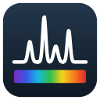 SpectraSP Better

Открытая замена программы **SpectraSP** для установки «монохроматор-спектрограф
SOL instruments **MS7504i** № 20126 + ПЗС-камера **PSI (ProScan)** 2048×506».

Программа работает **через штатные драйверы установленной SpectraSP** и берёт
адреса приборов из её же файлов (`Sensor_160082.xml`, `DevCtrl.ini`), поэтому
**ничего переподключать и перенастраивать не нужно**: камера остаётся на
`192.168.240.181`, монохроматор — на `192.168.120.120`. Файлы SpectraSP
программа не изменяет, старая SpectraSP продолжает работать как раньше
(только не запускайте обе программы одновременно).

Исходная выгрузка SpectraSP лежит в архиве
`СпектраСП выгрузка с компа из директории напрямую.rar`.

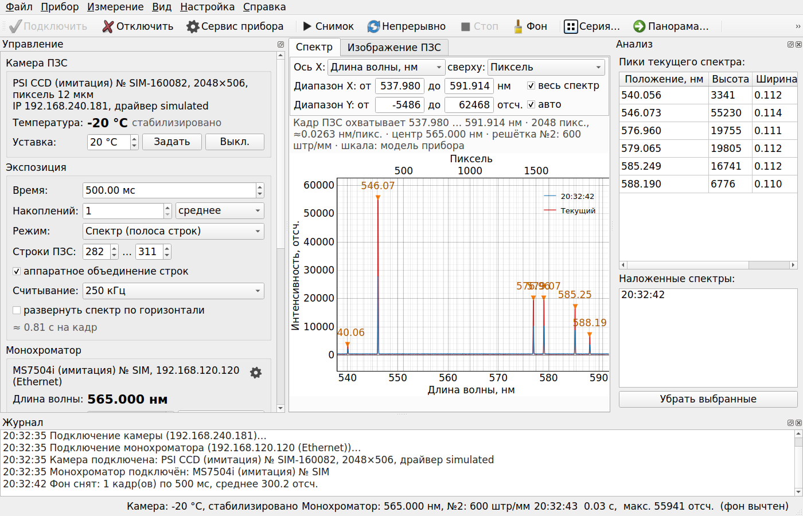

Слева — управление камерой, экспозицией, монохроматором и обработкой; в центре —
спектр или изображение ПЗС; справа — найденные пики и наложенные спектры; внизу —
журнал. Над графиком — выбор единиц и диапазона, под ним — что охватывает кадр.
Остальные окна — в разделе [«Как выглядит программа»](#как-выглядит-программа).

## Что было не так и что исправлено

Подробный разбор — в [docs/АНАЛИЗ_SpectraSP.md](docs/АНАЛИЗ_SpectraSP.md). Коротко
(по журналам самой SpectraSP за 11.09 и 25.09.2026):

| Проблема SpectraSP | SpectraSP Better |
|---|---|
| Один спектр при экспозиции 1 с снимается **≈9,7 с**: каждый раз читается весь кадр 2048×506 (4,2 с при 250 кГц), 2 МБ идут по сети (1,4 с), перед каждым кадром заново отправляются все параметры (≈1,1 с) | Спектральный режим с **аппаратным объединением строк** полосы: камера отдаёт одну строку (~10 мс считывания). Параметры отправляются только при изменении. Ожидаемо ≈1,1–1,3 с на спектр при экспозиции 1 с |
| Окно «замирает» на время экспозиции и движения монохроматора, долгую экспозицию не прервать | Приборы работают в отдельных потоках, кнопка «Стоп» прерывает экспозицию, зависание камеры определяется по таймауту |
| При запуске опрашиваются отсутствующие камеры (Andor, PSI Ver5 на несуществующем адресе) — лишние ≈4 с | Опрашиваются только реальные приборы; для старой SpectraSP есть утилита, выключающая лишний опрос |
| Журналы зашифрованы | Обычный текстовый журнал; утилита для расшифровки старых журналов |

Возможности новой программы:

* спектр (полоса строк, аппаратное или программное объединение) и полный кадр
  ПЗС для юстировки — полосу можно выбрать мышью на изображении;
* накопление N кадров (среднее/сумма) с отбраковкой космических частиц,
  удаление одиночных выбросов;
* темновой фон с автоматическим закрытием шторки и вычитанием;
* монохроматор: длина волны (со списком длин волн из SpectraSP), решётка, щели,
  выходное зеркало, шторка;
* окно «Сервис прибора» (значок шестерёнки) — то, что в SpectraSP пряталось в
  окне DevCtrl: шторка, зеркало, щели, решётка, положения шаговых двигателей в
  шагах, перемещение и сброс механизмов;
* лазер, подключённый к выходу синхронизации камеры, — кнопка «Включить/Выключить»
  в панели «Камера ПЗС»; режимы выходов синхронизации 1 и 2 — как в SpectraSP;
* охлаждение ПЗС с уставкой (при каждом запуске в поле +20 °C, чтобы случайное
  нажатие «Задать» не охладило матрицу; нужную температуру вводите сами),
  плавный отогрев до +2 °C перед выключением охлаждения и при выходе;
* защита приборов от ошибочных команд — см. «Защита оборудования»;
* ось X в нм (по умолчанию), пикселях, см⁻¹, рамановском сдвиге или эВ, плюс
  вторая шкала сверху (например, пиксели ПЗС); диапазон по X и Y задаётся
  числами «от … до» и запоминается; над графиком всегда написано, какой участок
  спектра охватывает кадр ПЗС; курсор показывает положение сразу в нм и
  пикселях;
* калибровка шкалы по модели прибора (та же, что в SpectraSP) с поправкой по
  реперным линиям Hg/Ar/Ne/He/H (автоматический поиск линий);
* поиск пиков с центром, шириной и подсказкой ближайшей справочной линии;
* серии спектров с интервалом и автосохранением, панорамный спектр со сшивкой;
* наложение сохранённых спектров для сравнения;
* сохранение в TXT (табуляция) или CSV для русского Excel, с метаданными
  (экспозиция, решётка, длина волны, температура, фон…);
* режим имитации — всё можно проверить без приборов.

## Как выглядит программа

Снимки сделаны в режиме имитации (без приборов, спектр ртутно-неоновой лампы);
с настоящими приборами окна те же. Стиль оформления в Windows немного другой.

### Единицы оси и диапазон

Здесь снизу рамановский сдвиг (лазер 532 нм), сверху — длина волны, по X задан
участок 300–1700 см⁻¹. Пики в таблице — в единицах оси.

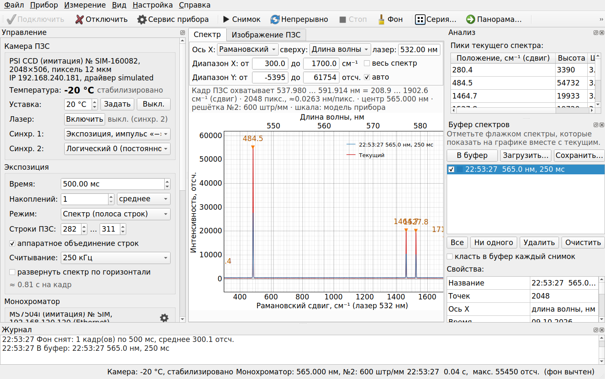

### Изображение ПЗС

Полный кадр для юстировки: жёлтая полоса — строки, по которым строится спектр
(её можно перетащить мышью). Столбцы подписаны в тех же единицах, что и спектр,
сверху — номера пикселей.

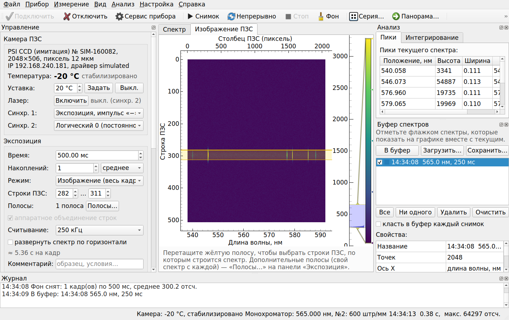

### Панорама

Спектр широкого диапазона сшивается из нескольких положений монохроматора.

| Параметры | Результат: 530–675 нм из трёх положений |
|---|---|
| 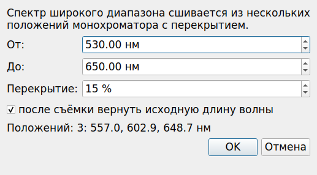 | 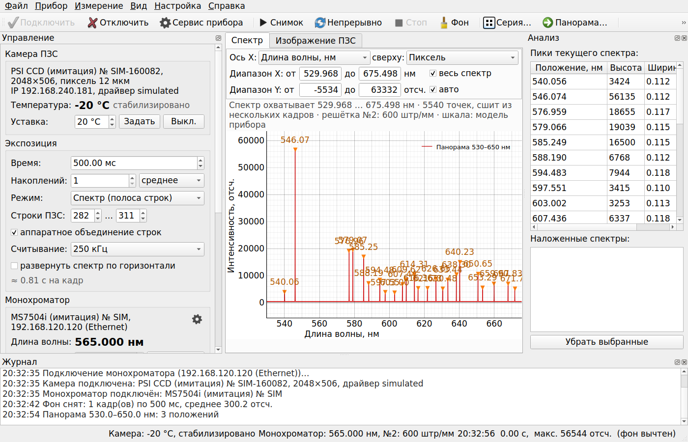 |

### Сервис монохроматора (шестерёнка)

То, что в SpectraSP было в скрытом окне DevCtrl: шторка, зеркало, щели, решётка,
длина волны, положения шаговых двигателей, перемещение и сброс механизмов.

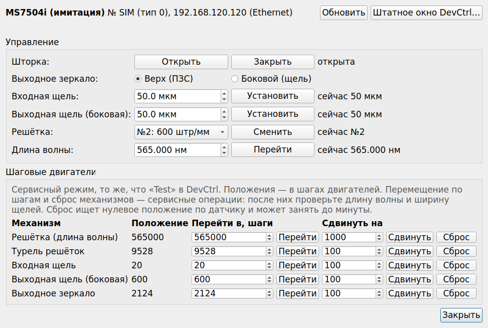

### Калибровка шкалы

Модель прибора (как в SpectraSP) и поправка по реперным линиям: программа сама
находит линии эталонной лампы в спектре и считает поправку.

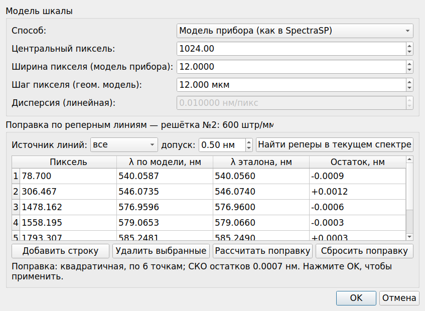

### Серия, настройки

| Серия спектров | Настройки |
|---|---|
| 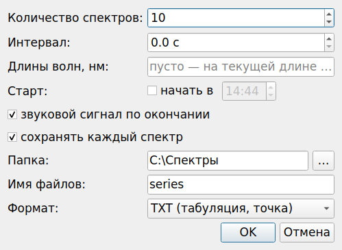 | 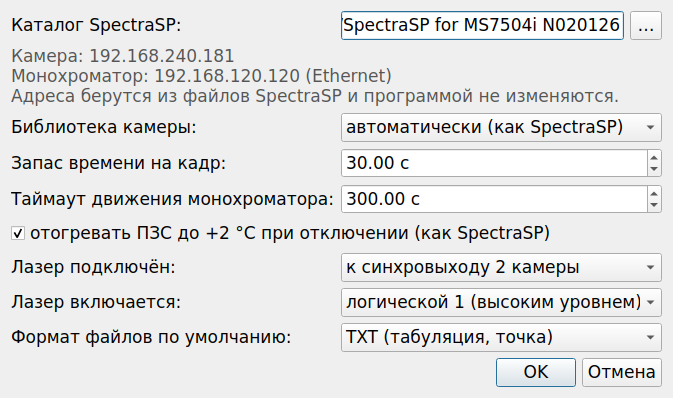 |

### Защита камеры

Уставка ниже 0 °C — только с подтверждением; холодную ПЗС программа сначала
отогревает, а при отключении показывает, как идёт отогрев.

| Охлаждение ниже 0 °C | Выключение охлаждения холодной ПЗС | Отключение приборов |
|---|---|---|
| 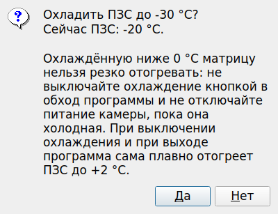 | 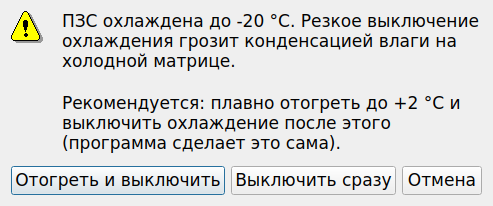 | 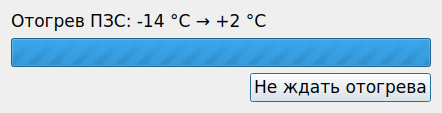 |

## Установка (Windows, компьютер с приборами)

Драйверы SpectraSP 32-битные, поэтому нужен **32-битный Python 3.12**.

1. Скачайте с <https://www.python.org/downloads/windows/> установщик
   **Python 3.12.x — Windows installer (32-bit)** и установите
   (отметьте «Add python.exe to PATH»; «py launcher» оставьте включённым).
2. Скопируйте эту папку на компьютер (например, `C:\SpectraSP-Better`).
3. Запустите `install.bat` — создаст окружение `.venv32` и установит
   PyQt5, pyqtgraph, numpy.
   *Нет интернета на лабораторном ПК?* Запустите `download_wheels.bat` на любом
   компьютере с интернетом и скопируйте папку вместе с появившейся папкой
   `wheels` — `install.bat` возьмёт пакеты из неё.
4. Закройте SpectraSP и запустите `probe.bat` — пошаговая проверка связи
   (только чтение: адреса, температура, длина волны, решётка, щели…).
   Отчёт сохраняется в `probe_ДАТА.txt`. С ключом `probe.bat --expose 100`
   дополнительно снимается пробный спектр 100 мс.
5. Запуск программы — `run.bat`. Без приборов — `run_simulation.bat`.
   При первом запуске на рабочем столе появятся ярлыки **«SpectraSP Better»** и
   **«SpectraSP Better (имитация)»** со значком программы — дальше можно
   запускать ими (без окна консоли). Если папку программы перенести, ярлыки
   обновятся при следующем запуске `run.bat`. Удалённый ярлык сам не
   возвращается — для этого есть `create_shortcuts.bat`.

Каталог SpectraSP ищется автоматически (`C:\ProgramData\SpectraSP for MS7504i N020126`
и другие `C:\ProgramData\SpectraSP*`); при необходимости укажите его в
«Настройка → Настройки…».

## Работа с программой

1. **Подключить** (Ctrl+K) — камера и монохроматор подключаются параллельно.
   Если запущена SpectraSP — программа предупредит.
2. Слева — управление:
   * «Камера ПЗС»: температура, уставка охлаждения (при запуске +20 °C;
     охлаждение включается только кнопкой «Задать»; пока ПЗС выходит на
     уставку, съёмка недоступна), лазер и выходы синхронизации;
   * «Экспозиция»: время, число накоплений, режим «Спектр»/«Изображение»,
     строки полосы, аппаратное объединение, скорость считывания, оценка
     времени кадра;
   * «Монохроматор»: длина волны, решётка, щель, выходное зеркало, шторка;
   * «Обработка»: вычитание фона, космические частицы, пики.
3. **Снимок** (F5), **Непрерывно** (F6), **Стоп** (Esc), **Фон** (F8).
4. **Изображение ПЗС**: переключите режим на «Изображение», снимите кадр и
   перетащите жёлтую полосу на след спектра — строки полосы обновятся.
   Затем вернитесь в режим «Спектр» для быстрых измерений.
5. **Калибровка шкалы** (меню «Настройка»): снимите спектр эталонной лампы,
   нажмите «Найти реперы в текущем спектре», проверьте соответствие линий,
   «Рассчитать поправку» → OK. Поправка хранится отдельно для каждой решётки.
6. **Сохранить** (Ctrl+S), **Открыть** для наложения (Ctrl+O), **Закрепить**
   текущий спектр (Ctrl+D), **Серия…**, **Панорама…**.
7. **Сервис прибора** (шестерёнка на панели инструментов и в панели
   «Монохроматор», меню «Прибор», Ctrl+Shift+D) — см. ниже.
8. **Вид графика** — панель над спектром, см. ниже.

Настройки: `%APPDATA%\SpectraSP-Better\settings.json`,
журнал: `%APPDATA%\SpectraSP-Better\logs\`.

### Вид графика: единицы и диапазон

Над спектром — панель вида:

* **Ось X** — в чём подписана нижняя ось: длина волны в нм (по умолчанию),
  пиксели ПЗС, волновое число (см⁻¹), рамановский сдвиг (см⁻¹, поле «лазер»
  появляется при его выборе) или энергия фотона (эВ).
* **сверху** — вторая шкала над графиком в других единицах, например пиксели
  ПЗС над нанометрами или рамановский сдвиг над нанометрами. Деления на ней
  стоят на круглых значениях своих единиц.
* **Диапазон X: от … до** — какой участок показывать. Флажок «весь спектр»:
  каждый новый спектр показывается целиком. Если ввести границы (Enter) или
  увеличить участок колесом мыши/перетаскиванием, флажок снимается и участок
  держится при следующих снимках, в том числе в непрерывном режиме. Заданный
  участок пересчитывается при смене единиц: 495–505 нм превратятся в
  19802–20202 см⁻¹ или в соответствующие пиксели.
* **Диапазон Y** — так же; «авто» подбирает масштаб по видимому участку.
* **Весь спектр** (Ctrl+A, панель инструментов, меню «Вид») — вернуть весь
  спектр по X и автомасштаб по Y.

Под панелью всегда написано, что охватывает кадр ПЗС: например, «Кадр ПЗС
охватывает 491.637 … 508.287 нм · 2048 пикс., ≈0.0081 нм/пикс. · центр
500.000 нм · решётка №1 · шкала: модель прибора». Если длина волны неизвестна
(монохроматор не подключён или в калибровке выбран режим «пиксели»), это
написано оранжевым, а ось подписана «Пиксель (нет шкалы длин волн)». Заданный в нм
участок при этом не теряется и вернётся, когда шкала появится.

Строка под графиком показывает положение курсора сразу в выбранных единицах,
в нм и в пикселях. Таблица пиков пишет положения в единицах оси, а
справочные линии ищет по длине волны при любых единицах. На вкладке
«Изображение ПЗС» ось столбцов подписана в тех же единицах, что и спектр
(пиксели — сверху). При сохранении, кроме длины волны и пикселей, пишется
столбец в выбранных единицах (см⁻¹, сдвиг или эВ).

Всё это запоминается в настройках и восстанавливается при следующем запуске.

### Сервисное окно монохроматора

В SpectraSP окно драйвера монохроматора (DevCtrl) открывалось только
сочетанием клавиш — кнопка для него на форме есть, но скрыта. Здесь то же
самое собрано в одно окно «Сервис монохроматора» (не модальное, можно
держать открытым рядом с графиком):

* **Управление**: шторка «Открыть»/«Закрыть» с текущим состоянием, выходное
  зеркало (на ПЗС / на боковую щель), ширина каждой щели в мкм, смена решётки,
  переход на длину волны;
* **Шаговые двигатели** (как режим «Test» в DevCtrl): решётка, турель, щели,
  зеркало — текущее положение в шагах, «Перейти в» (абсолютно), «Сдвинуть на»
  (относительно) и «Сброс» (поиск нулевого положения по датчику, до минуты).
  Выход за предел `MaxMayStepCount` из cfg-файла прибора программа не
  допускает. После сдвигов и сброса решётки/турели проверьте длину волны —
  при необходимости просто задайте её заново;
* **Штатное окно DevCtrl…** — открывает оригинальное окно драйвера, как в
  SpectraSP. В нём есть раздел Configuration с заводскими параметрами —
  без необходимости там ничего не меняйте: эти параметры записываются в
  cfg-файл прибора и влияют и на SpectraSP.

Всё, что меняется в сервисном окне, сразу отражается в панели «Монохроматор»
главного окна.

### Лазер и выходы синхронизации камеры

В SpectraSP лазер включали через выход синхронизации камеры («Выход синхр. 1/2»
в настройках сенсора). У этой установки в настройках SpectraSP выход 2 стоит в
режиме «LOGICAL 0» — постоянно низкий уровень, то есть лазер выключен; скорее
всего, именно к нему подключён лазер. (Выход «Шторка» монохроматора в SpectraSP
подписан «Вх. шторка» — это входная шторка, а не лазер.)

В панели «Камера ПЗС»:
* **Лазер: Включить / Выключить** — переключает выбранный выход между «Логическая 1»
  и «Логический 0». Какой выход и каким уровнем включается лазер — в
  «Настройка → Настройки…» (по умолчанию выход 2, включается логической 1).
  Включение — только после подтверждения; пока лазер включён, в строке состояния
  горит красная метка «ЛАЗЕР ВКЛ».
* **Синхр. 1 / Синхр. 2** — режимы выходов, как в SpectraSP: постоянный уровень
  или импульсы, привязанные к экспозиции (например, «Экспозиция, импульс «+»» —
  лазер светит только во время кадра). Значения берутся из настроек SpectraSP и
  передаются в камеру при подключении, как это делала SpectraSP (до этой
  версии программа их не передавала, и после включения питания камеры на
  выходах оставался режим «Экспозиция, импульс «−»»).

Лазер при подключении всегда выключен и выключается сам при отключении приборов
и выходе из программы. Если лазер подключён иначе (не к камере) — укажите в
настройках «не подключён», и кнопка будет недоступна.

### Про аппаратное объединение строк

При объединении заряды 30 строк суммируются в регистре камеры до оцифровки,
поэтому сигнал в 30 раз больше, а шум считывания — как у одной строки. Для
очень ярких линий это может привести к насыщению (программа показывает
«НАСЫЩЕНИЕ!») — уменьшите экспозицию или полосу строк, либо снимите флажок
«аппаратное объединение строк» (тогда полоса читается построчно и
суммируется программно — медленнее, но всё равно быстрее полного кадра).

## Защита оборудования

Программа не даёт выполнить действия, которые могут повредить приборы, или
делает их безопасно:

**Камера (ПЗС с охлаждением)**
* Уставка ниже 0 °C — только после подтверждения (при запуске в поле +20 °C).
* «Выкл.» охлаждения при холодной ПЗС предлагает «Отогреть и выключить»:
  уставка +2 °C, и охлаждение выключается само, когда матрица отогреется.
  Выключить сразу можно, но только осознанно.
* При отключении и выходе охлаждённая ниже 0 °C ПЗС плавно отогревается до
  +2 °C; в окне видно, как идёт отогрев. «Не ждать отогрева» оставляет в
  камере уставку +2 °C — не выключайте питание камеры, пока она холодная.
  Отключение этого отогрева в настройках требует подтверждения.
* Пока ПЗС выходит на новую уставку (температура дальше 1 °C от неё), съёмка
  недоступна — как в SpectraSP («Идет процесс изменения температуры камеры»).
  Смена уставки во время съёмки её останавливает. Если уставка недостижима
  (температура 2 минуты стоит на месте), съёмка снова разрешается с пометкой.
  Фон, снятый при температуре, отличающейся больше чем на 2 °C, не вычитается —
  программа просит переснять его.
* Если камера два опроса подряд сообщает о перегреве — охлаждение
  выключается, съёмка останавливается, появляется предупреждение.
  Если остановился вентилятор при включённом охлаждении — предупреждение.

**Монохроматор**
* Длина волны вне диапазона решётки, несуществующая решётка или положение
  зеркала, ширина щели больше допустимой (из файла прибора, для этого
  прибора ≈1980 мкм) — отклоняются до отправки в прибор.
* Сервисные перемещения по шагам — только в пределах `MaxMayStepCount` из
  файла прибора; если предел неизвестен, двигать по шагам нельзя (сброс по
  датчику остаётся). Сдвиг больше 5 % хода — с подтверждением.
* Пока идёт панорама или съёмка фона, ручные команды монохроматору (в том
  числе из сервисного окна) заблокированы; новая команда не отправляется,
  пока не завершилась предыдущая.
* При отключении и выходе программа дожидается окончания движения и только
  потом штатно закрывает DevCtrl — иначе он может не сохранить положение
  механизмов.

**Лазер (выход синхронизации камеры)**
* При подключении лазер всегда выключен, даже если в прошлый раз его оставили
  включённым; включение — только с подтверждением; при отключении приборов и
  выходе — выключается автоматически.
* Постоянно высокий уровень на другом выходе синхронизации — тоже с
  подтверждением.

**Две программы одновременно**
* Подключиться, пока запущены SpectraSP или DevCtrl, нельзя. Если их запустить
  при подключённых приборах, съёмка останавливается, а команды монохроматору
  блокируются до закрытия SpectraSP. `probe.bat` при запущенной SpectraSP
  ничего не делает.

Что остаётся на пользователе: не снимать задачу программы через диспетчер
задач и не выключать питание приборов во время движения монохроматора или
пока ПЗС холодная; не менять заводские параметры в разделе Configuration
штатного окна DevCtrl; соблюдать лазерную безопасность (лазером программа
управляет только через выход синхронизации камеры, ФЭУ не управляет вовсе).
«Выключить» во время съёмки прерывает текущий кадр, чтобы лазер погас сразу.

## Утилиты

| Команда | Назначение |
|---|---|
| `probe.bat [--expose МС] [--full-frame] [--goto НМ]` | диагностика приборов, отчёт в файл |
| `create_shortcuts.bat` | создать (заново) ярлыки программы на рабочем столе |
| `.venv32\Scripts\python -m spectra_better.logsp Logs\*.zip` | расшифровать журналы SpectraSP в текст |
| `.venv32\Scripts\python -m spectra_better.tools.tune_spectrasp [--apply / --restore]` | ускорить запуск оригинальной SpectraSP (выключить опрос отсутствующих камер; с резервной копией; адреса не меняются) |

## Если что-то не работает

* **«Драйверы SpectraSP 32-битные, а запущен 64-битный Python»** — установите
  32-битный Python 3.12 и заново выполните `install.bat`.
* **«Камера не отвечает на ping»** — камера выключена или не настроен сетевой
  адаптер (адрес ПК должен быть в той же подсети, что и для SpectraSP).
  Проверьте, что SpectraSP видит камеру.
* **«Монохроматор не отвечает (SSPL_IM.Init…)»** — прибор выключен, занят
  SpectraSP/DevCtrl или нет связи по сети.
* **«Failed to load psi_ccd5.dll»** (и одновременно ошибка `SSPL_IM.Init`) —
  драйверы ищут свои библиотеки рядом с запущенной программой, а не рядом
  с собой. Программа поэтому представляется драйверам как
  `<каталог SpectraSP>\SpectraSP.exe`; в отчёте `probe` это строка
  «путь программы для драйверов». Если там «НЕ ПОДМЕНЁН» — пришлите отчёт.
* **Шкала длин волн сдвинута** — «Настройка → Калибровка шкалы…»: центральный
  пиксель и поправка по реперным линиям. По умолчанию параметры взяты из
  SpectraSP (центральный пиксель 469), так что шкала совпадает со старой.
* Любая ошибка подробно пишется в журнал (`%APPDATA%\SpectraSP-Better\logs`);
  приложите его и отчёт `probe` к сообщению об ошибке.

## Честно о проверке

Программа и тесты проверены на имитаторах камеры и монохроматора (без
оборудования). Интерфейс драйверов восстановлен по бинарным файлам SpectraSP:
структуры данных — по встроенной в SpectraSP.exe информации о типах (точно),
сигнатуры функций — по местам их вызова в SpectraSP и размеру аргументов в DLL.
Первый запуск на приборах лучше начать с `probe.bat`, затем `probe.bat
--expose 100` и только потом основной программы. Если аппаратное объединение
строк на этой камере поведёт себя не так, как ожидается, достаточно снять
флажок «аппаратное объединение строк».

## Для разработчиков

```
spectra_better/
  hw/psi_structs.py, psi_camera.py   камера PSI через psi_ccd2_verN.dll
  hw/sspl_mono.py                    монохроматор через SSPL_IM.dll
  hw/simulated.py                    имитаторы
  hw/worker.py                       поток-«владелец» DLL с прокачкой сообщений
  instrument.py                      логика прибора (без Qt)
  calibration.py, processing.py      шкала длин волн, обработка
  spectrasp_config.py                чтение настроек SpectraSP (только чтение)
  gui/                               интерфейс PyQt5 + pyqtgraph
  logsp.py, tools/                   утилиты
docs/                                анализ SpectraSP и описание API драйверов
tests/                               pytest (работают на любой ОС, без приборов)
```

Тесты: `pip install -r requirements-dev.txt && python -m pytest`.
Запуск без приборов на любой ОС: `python -m spectra_better --simulate`.
Снимки экрана для этого README (в режиме имитации):
`python -m spectra_better.tools.screenshots` (в Linux без экрана — с
`QT_QPA_PLATFORM=offscreen`).
